  
    

  **Software Development Intern &bull; B.E. CSE @ NIE Mysuru (GPA: 9.32/10)**  
  *Building production-ready full-stack applications with Spring Boot, Java, and scalable backend architecture.*

   

  
  
  
  

---

### 👤 Profile Summary

- 🎓 **Education**: B.E. in Computer Science & Engineering at **The National Institute of Engineering, Mysore** (2024–2028) &bull; **GPA: 9.32 / 10.00**
- 💼 **Experience**: Software Development Intern at **OurContentCafe** (Spring Boot full-stack apps) and **Computer Systems and Services (M)** (production web platform + AI FAQ bot).
- 🏆 **Hackathons**: **College-Level Winner** at Smart India Hackathon (SIH) for *BharactresQ* &bull; **Top 5 / 120+ Teams** at National FinTech Hackathon for *CrediGraph*.
- 🧩 **DSA**: **200+ problems solved** across LeetCode, CodeChef, and GeeksforGeeks (LeetCode SQL 50 & 50 Days badges).

---

### 💻 Skills

| Category | Technologies |
| :--- | :--- |
| **Languages** | Java, Python, JavaScript, SQL, C, HTML5, CSS3 |
| **Backend & APIs** | Spring Boot, Spring MVC, Spring Data JPA, RESTful Web Services, Microservices, Maven |
| **Databases** | MySQL, PostgreSQL, MongoDB, JDBC |
| **Cloud & DevOps** | Git, GitHub, Docker, Postman, Vercel, Render |
| **Core CS & AI** | Data Structures & Algorithms, OOP, DBMS, Operating Systems, AI/ML Integration, NLP |

---

### 💼 Work Experience

#### **OurContentCafe** &mdash; *Software Development Intern*
`April 2026 – August 2026` &bull; *Java, Spring Boot, MySQL, Agile*
- Engineered and deployed production-ready full-stack applications for multiple business clients, translating client requirements into scalable technical solutions.
- Managed end-to-end production deployments and collaborated with cross-functional teams using Agile practices.

#### **Computer Systems and Services (M)** &mdash; *Software Development Intern*
`January 2026 – March 2026` &bull; *HTML5, CSS3, JavaScript, Google Apps Script, Vercel*
- Built and deployed a production business website with an AI-powered FAQ chatbot to automate customer queries.
- Optimized on-page SEO and performance with semantic HTML and asset compression to improve discoverability.

---

### 🚀 Key Projects

- **[CrediGraph](https://github.com/Utkarsharyan)** *(Python, Scikit-learn, ML, REST APIs)*  
  Financial risk and credit default prediction using Logistic Regression and Random Forest models with an AI risk chatbot. **Top 5 / 120+ teams** at a National FinTech Hackathon.

- **[FocusOS](https://focus--os.vercel.app/)** *(Spring Boot, Java, MySQL, JWT, REST APIs)* &bull; [GitHub](https://github.com/Utkarsharyan)  
  Microservices-style productivity SaaS with **50+ backend components**, JWT authentication via Spring Security, transaction-safe schema, and an AI productivity assistant.

- **[Government Budget YoY Tracker](https://github.com/Utkarsharyan)** *(Spring Boot, PostgreSQL, Chart.js, NLP)*  
  Full-stack financial transparency dashboard analyzing budget shifts year-over-year with an NLP engine parsing large-scale datasets.

- **[Vibify](https://vibify-app.vercel.app/)** *(Spring Boot, Java, Groq AI, REST APIs)* &bull; [GitHub](https://github.com/Utkarsharyan)  
  AI travel recommendation engine using hybrid APIs (Pixels + Wikipedia) to generate personalized itineraries.

---

### 🏆 Key Achievements

- 🥇 **Smart India Hackathon (SIH) College Winner**: Built *BharactresQ*, an AI-powered disaster prediction system with ML pipelines.
- 🥉 **National FinTech Hackathon**: Top 5 out of 120+ competing teams for *CrediGraph*.
- 🧩 **200+ DSA Problems Solved**: Active problem solver with LeetCode SQL 50 and 50 Days badges.
- 📈 **700+ GitHub Contributions**: Consistent daily development across open-source and client projects.

---

  Open to Software Engineering & Backend Internships &bull; utkarsh08aryan@gmail.com &bull; Mysore, India

